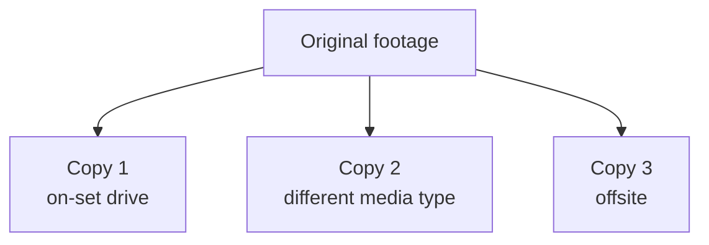

---
aliases:
tags:
  - glossary/davinci-resolve
---
# 3-2-1 Backup Rule

## Definition
The data-management protocol taught in this course: three total copies, on two different storage mediums, with at least one copy stored offsite. The hard floor is at minimum two copies — "if a file doesn't exist in two places, it doesn't exist at all."

## In Practice
Framed as ideal practice rather than a rigid minimum. Paired with [[Atlas/Notes/Student Notes/Color for Digital Cinema/Glossary/Checksum Verification (Checksum-Verified Copying)]] as the two pillars of responsible on-set data management — a backup that wasn't checksum-verified isn't a trustworthy backup, regardless of how many copies exist.

## Teaching Analogies & Examples
- **Never trusting one basket with all your eggs**: 3 total copies, on 2 different types of storage, with 1 copy stored somewhere else entirely — the discipline that means a single dropped hard drive, a single house fire, or a single corrupted card can never take out the only copy of footage that was physically impossible to reshoot.
## Related Terms
[[Atlas/Notes/Student Notes/Color for Digital Cinema/Glossary/Checksum Verification (Checksum-Verified Copying)]], [[Atlas/Notes/Student Notes/Color for Digital Cinema/Glossary/DIT (Digital Imaging Technician)]]

## Further Resources

3 total copies, on 2 different storage types, with 1 stored somewhere else entirely — three separate failure points would all have to fail at once to lose the footage.

## Appears In

[[Lesson 07 - Pre-Production and DIT Workflow]]
