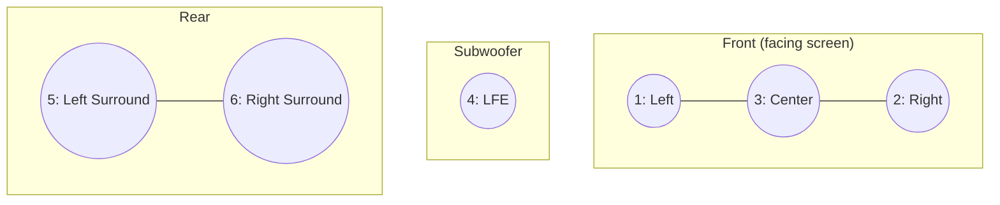

---
aliases:
  - 5.1
  - Surround Sound
tags:
  - glossary/davinci-resolve
---
# 5.1 Surround (Channel Order, Panning)

## Definition
Channel order: Left, Right, Center, LFE (subwoofer), Left Surround, Right Surround. Each adjacent pair of channels shares a pan destination — L/R pan left/right; Center and LFE are considered a pair too (Center pans hard left, LFE hard right); Left Surround/Right Surround pan as their own pair. **Odd-numbered channels (1, 3, 5) always pan hard left; even-numbered (2, 4, 6) always pan hard right** — this consistent rule is what routes each channel to its correct physical speaker on export.

## In Practice
If mastering 5.1 and stereo together, 5.1 always comes first (tracks 1–6), stereo second (tracks 7–8, continuing the same odd/even panning logic) — the stereo mix is treated as a *derivative* of the surround master. In Resolve's Fairlight page, selecting tracks 1–6 in order and clicking the "5.1" Link Group button (not "5.1 Film," a different regional channel order) auto-labels and correctly routes all six tracks at once — no manual per-track panning or output assignment required the way Premiere's setup demands. In Premiere, panning and **output channel assignment** are two separate, both-necessary steps that are easy to conflate: panning determines left/right side of a stereo pair; output assignment determines which physical channel pair a track routes to.

## Teaching Analogies & Examples
- **Six speakers in a specific, agreed-upon seating chart**: 5.1 surround is five main speakers (front left/center/right, rear left/right) plus one subwoofer (the ".1"), each assigned to a specific, standardized channel position — get the channel order wrong on delivery and dialogue can end up playing from a rear speaker instead of the center, the audio equivalent of the seating chart getting scrambled at a wedding.
## Related Terms
[[Slate (Delivery)]], [[Two-Pop (Color Bars and Tone)]], [[Fairlight (Audio Page)]]

## Further Resources

Odd channels (1, 3, 5) always pan hard left; even channels (2, 4, 6) always pan hard right — that consistent rule is what routes each numbered channel to its correct physical speaker on export, regardless of which pair it belongs to.
