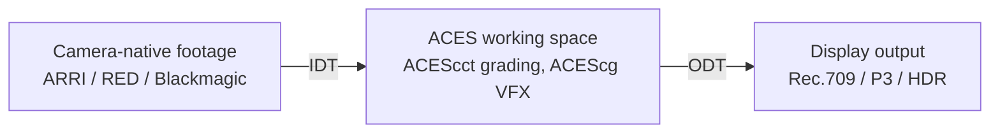

---
aliases:
  - Academy Color Encoding System
tags:
  - glossary/davinci-resolve
---
# ACES

## Definition
Academy Color Encoding System — the Academy's (the Oscars people) standardized color management workflow. Not "the" standard, just a very common one. Lets you grade an entire project in one large working color space, with technical transforms handling input (camera-specific: ARRI, RED, Blackmagic, etc.) and output (Rec. 709, P3, HDR, whatever deliverables are needed) automatically.

## In Practice
ACES is **scene-referred** — its explicit goal is to strip camera-manufacturer-specific color bias rather than apply a look, giving the colorist full control over the eventual look rather than inheriting whatever a camera baked in. See [[Color Space Referents (Display-, Camera-, Scene-Referred)]]. Despite that "no bias" framing, ACES's own transform math does have a characteristic clean, filmic highlight/shadow rolloff that's genuinely recognizable — both things are true simultaneously (no camera bias, but real ACES-transform character). Grading actually happens in **ACEScct** (a log-gamma working space); compositing/VFX work happens in **ACEScg** (linear) — see [[ACEScg vs. ACEScct (ACES Working Spaces)]]. Set up per-clip via [[IDT (Input Device Transform)]] and [[ODT (Output Device Transform)]], or project-wide via Project Settings → Color Management → ACES. A key payoff: the Output Transform can be switched later (Rec. 709 → Rec. 2020 PQ, or an archival format) without touching the underlying grade at all.

**Version currency note**: this course was taught on ACES 1.x (the IDT → working space → RRT + ODT pipeline described above). The Academy released **ACES 2.0** in April 2025, which meaningfully restructures parts of this — most notably merging the RRT and ODT into a single Display Rendering Transform (DRT) per output format, plus a new gamut-mapping model. DaVinci Resolve added ACES 2.0 support starting around Resolve 20 (beta, as of mid-2026). ACES 1.x remains widely supported and this course's workflow is still valid, but worth knowing the two-transform (RRT+ODT) framing taught here has since been simplified in the newer spec.

## Teaching Analogies & Examples
- **A universal translator, not a style**: ACES doesn't make anything look a certain way — it's a common language that every camera's footage gets translated into (via an IDT) so they can all sit in the same room and be graded together, then translated back out (via an ODT) to whatever screen it's playing on.
- **A hub-and-spoke airport instead of everyone flying direct**: without a common working space, every camera-to-display combination needs its own conversion (RED-to-broadcast, Alexa-to-DCP, etc.) — ACES puts one hub in the middle so every format only needs to know the route in and the route out, not a route to every other format.
## Related Terms
[[IDT (Input Device Transform)]], [[ODT (Output Device Transform)]], [[ACEScg vs. ACEScct (ACES Working Spaces)]], [[Color Space Referents (Display-, Camera-, Scene-Referred)]], [[LMT (Look Modification Transform)]], [[Resolve Color Management (RCM)]], [[Color-Managed Workflow]]

## Further Resources

The hub-and-spoke shape is the whole point: every camera only needs a route in, every display only needs a route out.
