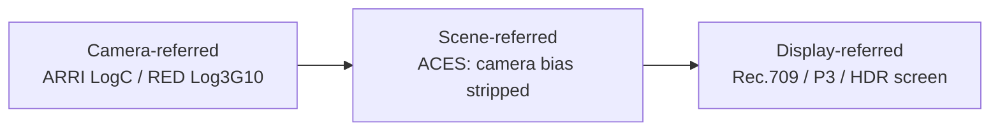

---
aliases:
tags:
  - glossary/davinci-resolve
---
# Color Space Referents (Display-, Camera-, Scene-Referred)

## Definition
Three ways a color space can be anchored:
- **Display-referred**: tied to a specific display/output target. Footage shot directly into Rec. 709 (phone cameras, camcorders, non-log recording) is display-referred, as is any traditional gamma-workflow grade. Limited — clipped highlights/crushed shadows have no recovery path, since the data was never captured beyond that display's range.
- **Camera-referred**: a manufacturer's own wide-gamut log space (ARRI LogC, RED Wide Gamut/Log3G10, Sony S-Log, Panasonic V-Log). Grading can happen directly within one camera's referred space.
- **Scene-referred**: represents what was actually seen on set, stripped of any camera-manufacturer-specific color bias. [[Atlas/Notes/Student Notes/Color for Digital Cinema/Glossary/ACES]] is scene-referred.

## In Practice
This is the conceptual backbone of why color management exists: a display-referred grade is stuck at whatever space it was graded in, while a scene-referred pipeline like ACES preserves the option to output to multiple delivery formats later without re-grading. Worth noting as a deliberate creative tradeoff: if a specific camera's inherent bias is something you actually want preserved, ACES's scene-referred approach works against that intent, not for it.

## Teaching Analogies & Examples
- **Three different questions about the same photo**: "what did the scene actually look like in person" (scene-referred), "what did this specific camera happen to record" (camera-referred), and "what should the final screen show" (display-referred) are three different reference points for describing color — the same image data means something different depending on which question you're answering.
- ACES's whole design is easiest to explain once this distinction is clear: it works in scene-referred space specifically because that's the one reference point that's the same regardless of which camera shot the footage or which screen it'll play on — the neutral middle ground between camera-referred in and display-referred out.
## Related Terms
[[Atlas/Notes/Student Notes/Color for Digital Cinema/Glossary/ACES]], [[Atlas/Notes/Student Notes/Color for Digital Cinema/Glossary/Gamma Workflow (Non-Color-Managed)]], [[Atlas/Notes/Student Notes/Color for Digital Cinema/Glossary/Color-Managed Workflow]], [[Atlas/Notes/Student Notes/Color for Digital Cinema/Glossary/Log (Footage)]]

## Further Resources

Three different answers to "what did this image actually look like," moving from a specific camera's own log space, through the neutral scene-referred middle ground, to a specific screen's final display space.

## Appears In

[[Lesson 12 - Color Management and ACES]]
