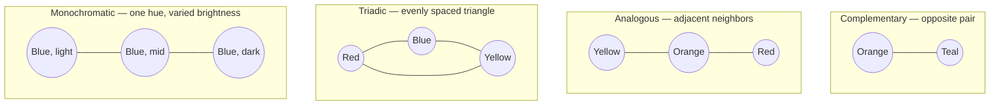

---
aliases:
  - Teal and Orange
tags:
  - glossary/davinci-resolve
---
# Complementary (Color Scheme)

## Definition
Two opposing colors on the wheel as the dominant palette. Called out in this course as probably the most common/successful scheme, since opposing hues create color contrast that makes an image "pop."

## In Practice
Teal-and-orange is the most iconic variant, singled out partly because human skin tones sit in the orange range — making everything else teal/blue makes faces stand out by opposition. Reinforced again in the secondaries lessons: pushing everything but skin toward blue/teal (via Hue-vs-Hue curves) is a recurring eye-direction technique, not just a stylistic default. A student question about a blue+red combination that isn't quite complementary or analogous got the answer that it's close enough to complementary to call it that (true opposition would be red vs. cyan specifically).

## Teaching Analogies & Examples
- **Two people standing directly across from each other, arguing loudly**: colors directly opposite on the wheel create maximum visual contrast/tension when paired — which is exactly why they "pop." Teal-and-orange is the iconic version specifically because skin tones sit in the orange range, so pushing everything else teal makes faces the one thing standing out by opposition.
- Worth having students point at a movie poster and identify the two opposing colors at work — this scheme is genuinely everywhere once you know to look for it, which makes for an easy, high-hit-rate classroom exercise.
## Related Terms
[[Atlas/Notes/Student Notes/Color for Digital Cinema/Glossary/Monochromatic (Color Scheme)]], [[Atlas/Notes/Student Notes/Color for Digital Cinema/Glossary/Analogous (Color Scheme)]], [[Atlas/Notes/Student Notes/Color for Digital Cinema/Glossary/Triadic (Color Scheme)]], [[Hue/Sat/Lum Curves]]

## Further Resources

All four schemes are really just different picking patterns on the same wheel — how far apart the chosen hues sit, and how many of them there are. See [[Atlas/Notes/Student Notes/Color for Digital Cinema/Glossary/Analogous (Color Scheme)]], [[Atlas/Notes/Student Notes/Color for Digital Cinema/Glossary/Triadic (Color Scheme)]], and [[Atlas/Notes/Student Notes/Color for Digital Cinema/Glossary/Monochromatic (Color Scheme)]], which link back here rather than repeating this diagram.

## Appears In

[[Lesson 10 - Secondaries Part 1 and Color Theory Part 2]]
