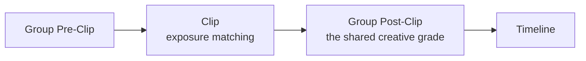

---
aliases:
  - Groups
tags:
  - glossary/davinci-resolve
---
# Group Grading (Groups)

## Definition
Grading multiple clips sharing a setup at once. Flag clips by angle/setup, filter to that flag, select all, and Add to New Group (named descriptively, e.g. "Wide Shot") — grouped clips display a colored chain-link icon. Grouped clips gain two additional grading levels beyond the normal clip/timeline split: **Group Pre-Clip** and **Group Post-Clip**. A grade applied to any instance's group level applies to *every* clip in that group simultaneously.

## In Practice
**Full order of operations**: Pre-Clip → Clip → Post-Clip → Timeline. This course's personal-practice default: primaries and secondaries for an entire angle/setup go on the group **Post-Clip** level (applies once, to every instance of that setup across the whole film); the individual **Clip** level is reserved specifically for exposure-matching tweaks between takes of the same setup — conceptually equivalent to an on-set exposure adjustment, which is why it sits earlier in the order than the group's creative grade. Tracking and keyframing belong at the clip level too, since neither makes sense applied group-wide. If a group-level selection (a power window or qualifier) doesn't correctly cover one outlier clip, fix that clip's exposure at the Clip level rather than customizing the group selection (which would affect every other clip too) — or pull the outlier out of the group entirely. **Known limitation**: groups cannot be nested (no scene group containing angle sub-groups). A lighter-weight alternative for propagating adjustments across clips is a [[Shared Node]], used less often in this course's stated preference.

## Teaching Analogies & Examples
- **[[Shared Node]]'s bigger sibling**: where a Shared Node links one specific adjustment across clips, Group Grading links entire clips together as a set — apply a grade to the group and every member updates together, useful for a whole scene or a whole location's footage that should always move as one unit rather than being kept in sync by hand.
## Related Terms
[[Flags (Flagging)]], [[Shared Node]], [[Versions (Grade Versioning)]]

## Further Resources

The order matters: exposure gets matched per-clip before the group's shared creative grade is applied on top, so every instance of a setup lands on the same creative look regardless of small on-set exposure differences between takes.
