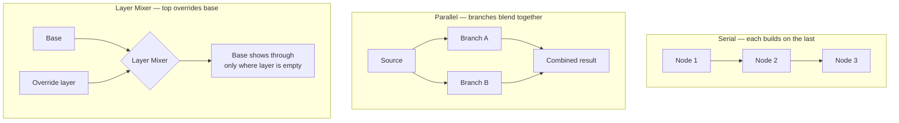

---
aliases:
  - Layer Node
tags:
  - glossary/davinci-resolve
---
# Layer Mixer

## Definition
A node that *overrides/bypasses* the node above it rather than building on it (Option+L) — unless a selection is made within the layer mixer, in which case only that selection is excluded from the override, letting the node above show through just there. Visually similar-looking to a [[Atlas/Notes/Student Notes/Color for Digital Cinema/Glossary/Parallel Node]] but functionally different, distinguished by a small icon on the node itself.

## In Practice
Referred to interchangeably in this course as "layer node" and "layer mixer" — they're the same node type; "Layer Mixer" is Resolve's actual name for it (visible in the Add Node menu), "layer node" is informal shorthand. Genuinely one of the trickiest, most-confused concepts in the course's node vocabulary, given how similar it looks to a parallel node while behaving oppositely (override vs. blend). Central to a huge range of techniques covered: the "black and white except one color" trick, sky-replacement compositing, clone-stamp patching (protecting an area a background patch shouldn't cover), bleach bypass (via a Composite Mode like Soft Light), and rescuing a tracking failure by masking out the bad frames with a luma key inside the layer mixer.

**Composite Modes**: beyond the default override behavior, a layer mixer supports blend modes (Overlay, Soft Light, etc.) — e.g. Soft Light for a bleach-bypass look, Overlay for a film-grain overlay.

## Teaching Analogies & Examples
- **Stacking transparent slides on an overhead projector**: each layer sits on top of the last, and where a layer has no image (fully transparent), the one beneath it shows through — the Layer Mixer composites its inputs the same way, top layer wins wherever it isn't transparent.
- Contrast with a Parallel Node's math: a Parallel Node *blends/adds* what its branches produce, while a Layer Mixer *stacks and shows through* — "adds together" vs. "layers on top of" is the one-line distinction worth repeating.
## Related Terms
[[Atlas/Notes/Student Notes/Color for Digital Cinema/Glossary/Parallel Node]], [[Atlas/Notes/Student Notes/Color for Digital Cinema/Glossary/Serial Node]], [[Atlas/Notes/Student Notes/Color for Digital Cinema/Glossary/Outside Node]], [[Atlas/Notes/Student Notes/Color for Digital Cinema/Glossary/Bleach Bypass]], [[Atlas/Notes/Student Notes/Color for Digital Cinema/Glossary/Grain (Film Grain Emulation)]], [[Atlas/Notes/Student Notes/Color for Digital Cinema/Glossary/Clone Stamp Technique]]

## Further Resources

All three look like "multiple nodes connected," but the math is different: Serial passes the image down a line, Parallel hands out copies and adds the results, Layer Mixer stacks and shows through — the same shape of confusion this course flags directly (Layer Mixer and Parallel look alike but behave oppositely).

## Appears In

[[Lesson 06 - Color Theory]], [[Lesson 10 - Secondaries Part 1 and Color Theory Part 2]], [[Lesson 11 - Secondaries Part 1 Lab 06]], [[Lesson 13 - Relighting and Clone Stamp Technique]], [[Lesson 15 - Tracking and Keyframing]], [[Lesson 16 - Creating Looks Part 1]], [[Lesson 17a - Sky Replacements]], [[Lesson 19 - Misc Color Tips]], [[Lesson 19b - Practicing Looks]], [[Lesson 19c - Practicing Looks II]]
