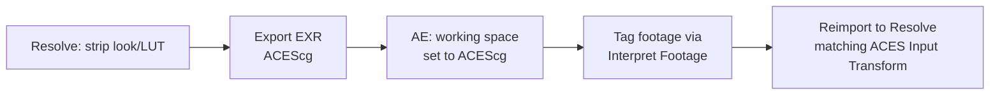

---
aliases:
  - OpenColorIO
tags:
  - glossary/davinci-resolve
---
# OCIO (OpenColorIO)

## Definition
An open-source color management technology used to move color-managed footage between applications that don't share Resolve's native ACES implementation — most relevantly, After Effects and Premiere. Distinct from Resolve's own ACES/RCM color management, but interoperable with it when set up correctly.

## In Practice
Very recent versions of After Effects (2023 onward) added native OCIO-based ACES support directly in Project Settings (Color Management Engine → OCIO). The core workflow: strip the timeline-level look/LUT before sending a shot to VFX, export as EXR in ACEScg or ProRes 4444 tagged with an ACES space, set AE's working space to ACEScg, tag each imported asset's color space correctly via Interpret Footage, and sandwich any Rec.709-native tools (like Lumetri) between OCIO transforms so they operate in their native space without breaking the surrounding color-managed pipeline. Reimporting the finished VFX element back into Resolve with a matching ACES Input Transform produces zero color shift relative to the original — the entire point of a properly color-managed round trip.

## Teaching Analogies & Examples
- **A universal power adapter that any app can plug into**: OCIO is an open, shared standard for describing color-space conversions that many different tools (not just Resolve) can read and apply consistently — instead of every application inventing its own private conversion logic, they can all plug into the same shared config file and get the same result.
## Related Terms
[[ACES]], [[ACEScg vs. ACEScct (ACES Working Spaces)]], [[Color-to-VFX Workflow (Pipeline Order)]], [[EXR (OpenEXR)]]

## Further Resources

The round trip only stays color-accurate if every stage tags its color space correctly — skip a step and the reimport won't match the original.
