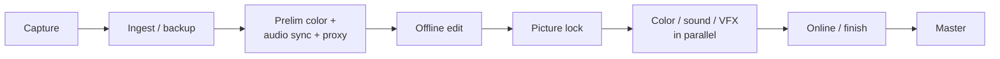

---
aliases:
  - Online/Offline Workflow
  - Online
  - Offline
tags:
  - glossary/davinci-resolve
---
# Online/Offline Workflow

## Definition
The full production pipeline: capture → ingest/backup → preliminary color + audio sync + proxy creation (the DIT's territory) → logging/assistant editing → editing (offline) → picture lock → color/sound/VFX happen in parallel → everything reassembles in the online/finish → master.

## In Practice
Reinforced throughout this course as the shared mental map underneath [[Conforming]], [[Roundtripping]], and [[Color-to-VFX Workflow (Pipeline Order)]] — each of those techniques is really about correctly handing footage across one specific seam in this larger flowchart. In a real color house, the file-translation handoff between offline and online is typically the **assistant colorist's** job — the lead colorist only touches the actual grade.

## Teaching Analogies & Examples
- **Sketching with a cheap pencil before painting with the good oils**: the "offline" stage is fast, disposable creative decision-making using lightweight [[Proxy (Editing Proxies)|proxy]] media — editing decisions get made quickly without waiting on huge files. The "online" stage is where those decisions get [[Conforming|conformed]] back onto the real, full-quality footage for the actual finish. The sketch and the final painting represent the same image; only the material working with it changes.
## Related Terms
[[Conforming]], [[Roundtripping]], [[Color-to-VFX Workflow (Pipeline Order)]], [[DIT (Digital Imaging Technician)]]

## Further Resources

Every technique this course teaches for handing footage between departments — Conforming, Roundtripping, the Color-to-VFX pipeline — is really about one specific seam in this larger flow.
