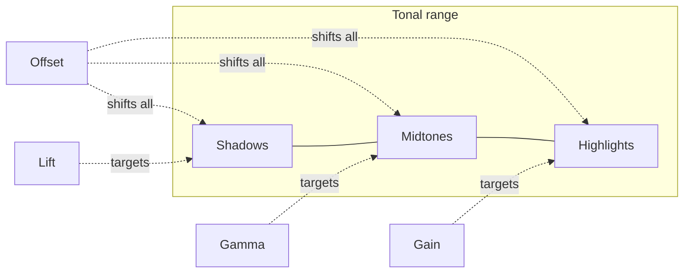

---
aliases:
  - Lift
  - Gain
  - Offset
tags:
  - glossary/davinci-resolve
---
# Primary Wheels (Lift, Gamma, Gain, Offset)

## Definition
The default color wheels used for primary grading: **Lift** (shadows), **Gamma** (midtones — see [[Atlas/Notes/Student Notes/Color for Digital Cinema/Glossary/Gamma]] for the color-space-property sense of this same word), **Gain** (highlights), **Offset** (overall exposure, shifting all three simultaneously). Originally engineered for non-color-managed, display-space grading, but still the default workhorse most colorists reach for even in modern color-managed pipelines — largely habit/feel, not necessity.

## In Practice
A recurring rule across this course's secondary/beauty-grading work: when brightening a selection, deliberately keep Lift/shadows low (don't lift them uniformly) — lifting shadows along with a brightened midtone/highlight push is what makes a power-window adjustment look "obviously graded" rather than natural. On a physical control panel, the Offset button remaps the wheels to Temperature/Tint instead of Lift/Gain. Printer Lights offer a numeric-keypad alternative to the wheels for fast global/offset adjustments — see [[Atlas/Notes/Student Notes/Color for Digital Cinema/Glossary/Printer Lights]].

## Teaching Analogies & Examples
- **Three separate volume knobs for three parts of a mix**: Lift is the bass (shadows), Gamma is the mids (midtones), Gain is the treble (highlights) — each wheel primarily affects its own zone, though real footage means the effects blend at the boundaries, the same way EQ bands aren't perfectly isolated either.
- Offset is worth explaining as the odd one out: instead of targeting one zone, it shifts the whole image at once, evenly across shadows/mids/highlights together — the "master volume" fader next to the three individual band knobs.
## Related Terms
[[Atlas/Notes/Student Notes/Color for Digital Cinema/Glossary/Gamma]], [[Atlas/Notes/Student Notes/Color for Digital Cinema/Glossary/Log Wheels (Shadow, Midtone, Highlight, Offset)]], [[Atlas/Notes/Student Notes/Color for Digital Cinema/Glossary/HDR Wheels]], [[Atlas/Notes/Student Notes/Color for Digital Cinema/Glossary/Printer Lights]], [[Atlas/Notes/Student Notes/Color for Digital Cinema/Glossary/Temperature]], [[Atlas/Notes/Student Notes/Color for Digital Cinema/Glossary/Tint]]

## Further Resources

Lift, Gamma, and Gain each aim at one zone; Offset is the odd one out, nudging all three at once.

## Appears In

[[Lesson 09 - Codecs and Primaries and Shot-Matching Part 2]]
