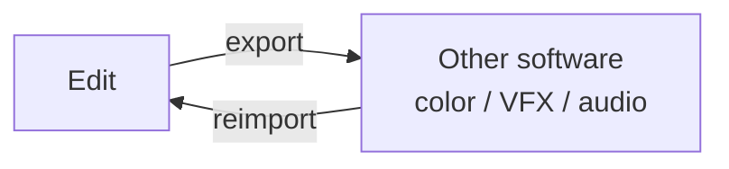

---
aliases:
  - Onlining
tags:
  - glossary/davinci-resolve
---
# Roundtripping

## Definition
The full circle: edit → send to another software (color, VFX, audio) → that software does its work → send back to the original edit software. "Onlining" is the specific stage where graded/finished elements get reassembled into the final master.

## In Practice
This course's simple roundtrip lab: disable transforms/reframes and turn off Output Blanking before export (the online editor will reapply reframe data on the uncolored clips, and Output Blanking's guides shouldn't get baked in), export as individual clips with handles via an intermediate codec, then reimport just the XML into a fresh edit project so it links to the already-graded clips rather than re-pulling proxies. The fuller version — building a proper master with slate, two-pop, and full surround audio — is covered under [[Atlas/Notes/Student Notes/Color for Digital Cinema/Glossary/Slate (Delivery)]], [[Atlas/Notes/Student Notes/Color for Digital Cinema/Glossary/Two-Pop (Color Bars and Tone)]], and [[5.1 Surround (Channel Order & Panning)]].

## Teaching Analogies & Examples
- **Sending a document to a collaborator, then getting it back to keep working**: an edit moves out of Resolve into another app (or vice versa) for work Resolve isn't suited for, then comes back — like emailing a draft to an editor for markup and receiving it back to continue writing, rather than the document staying permanently on one side of the exchange.
## Related Terms
[[Atlas/Notes/Student Notes/Color for Digital Cinema/Glossary/Conforming]], [[Online/Offline Workflow]], [[Atlas/Notes/Student Notes/Color for Digital Cinema/Glossary/Output Blanking]], [[Atlas/Notes/Student Notes/Color for Digital Cinema/Glossary/Use Unique Filenames]]

## Further Resources

The defining shape is the round trip itself — work leaves the edit, gets done elsewhere, and comes back to the same project rather than staying permanently on one side.

## Appears In

[[Lesson 08 - Conforming and Roundtripping]]
