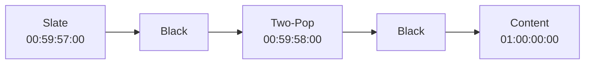

---
aliases:
tags:
  - glossary/davinci-resolve
---
# Slate (Delivery)

## Definition
A graphic at the head of a delivery master containing show title, delivery date, codec, frame rate, resolution, audio channel layout description, and Total Running Time — see [[TRT (Total Running Time)]].

## In Practice
Placed at the very start of a master's timeline (a standard start time like 00:59:57:00 gives room before the industry-standard "hour mark," 01:00:00:00, where the actual content begins). No universal formatting standard exists — follow a specific vendor's template if provided, otherwise include the core information clearly. Cut to an exact duration (e.g. 1 second) using the frame-precise numeric-keypad shortcut (`+1.` then Enter). Immediately followed by black, then the [[Two-Pop (Color Bars and Tone)]], then content.

## Teaching Analogies & Examples
- **A cover sheet stapled to the front of a submitted package**: the delivery Slate is a title card at the very start of the final file — project title, running time, spec info, delivery date — the paperwork equivalent of a cover sheet on a physical package, giving whoever receives the file the essential facts before they even watch a frame. Conceptually related to, but a very different object from, the on-set clapperboard Slate used during production.
## Related Terms
[[Two-Pop (Color Bars and Tone)]], [[TRT (Total Running Time)]]

## Further Resources

The whole sequence exists to get picture and audio to line up exactly at the industry-standard hour mark, with the two-pop's single beep two seconds earlier giving anyone downstream one unambiguous point to check sync against.
