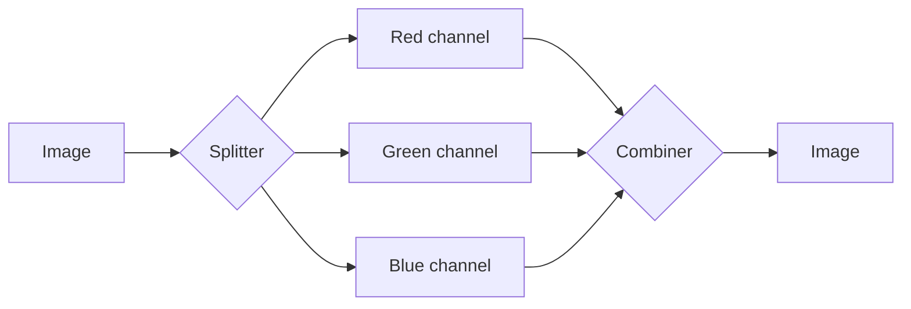

---
aliases:
  - Splitter/Combiner Node
tags:
  - glossary/davinci-resolve
---
# Splitter/Combiner Node

## Definition
Splits an image into its three RGB channels for independent manipulation (found under the Color Nodes menu).

## In Practice
Niche but genuinely useful for channel-specific noise (the blue channel is typically the noisiest on digital sensors), chromatic-aberration correction (realigning channels), or intentional glitch/experimental effects. The OFX Chromatic Aberration correction tool (part of the [[OFX Plugin Tour (Misc Effects Survey)]]) works on the same underlying principle of adjusting color channels independently.

## Teaching Analogies & Examples
- **Pulling the RGB channels apart onto separate workbenches, then pushing them back together**: a Splitter breaks an image into its individual Red, Green, and Blue components so each can be adjusted completely independently — like separating egg whites from yolks to treat them differently — then a Combiner reassembles them back into one image afterward.
## Related Terms
[[RGB Channels]], [[OFX Plugin Tour (Misc Effects Survey)]]

## Further Resources

Each channel can be graded, denoised, or realigned completely independently between the split and the combine.
