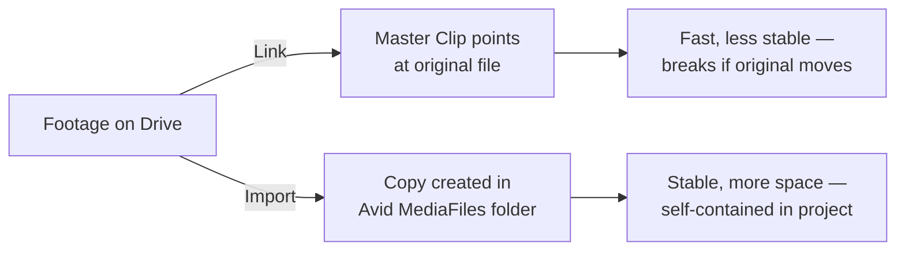

---
tags:
  - glossary/editing-1
  - glossary/avid
---
# Import vs. Link

## Definition
The two ways to bring footage into an Avid project. **Link** points a master clip directly at the original media file where it already lives, with no copy or conversion — fast and space-efficient, but dependent on that original file staying put. **Import** copies the footage into Avid's own MediaFiles folder and converts it to Avid-native media — slower and heavier on disk, but self-contained and stable.

## Teaching Analogies & Examples
- **Renting vs. buying a moving truck**: Link is like borrowing the neighbor's truck when you need it — fast and free, but if they move it, you're stuck. Import is buying your own truck — costs more space and time up front, but it's yours no matter what the neighbor does.
- **A shortcut icon vs. a copied file on your desktop**: a Link is a shortcut pointing at the original — delete or move the original and the shortcut breaks. An imported file is an actual copy sitting safely in Avid's own folder.
## Related Terms
[[Reveal File]], [[Delete Masterclip vs. Delete Associated Media Files]], [[Source Browser]]

## Further Resources

#glossary/editing-1
