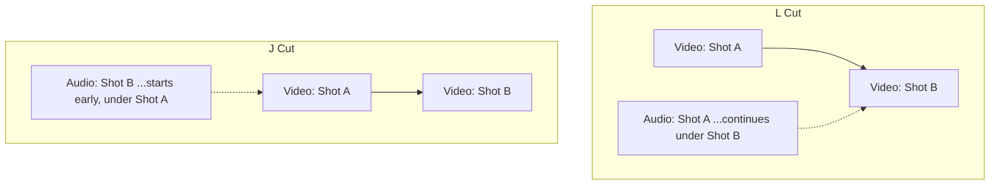

---
aliases:
  - Split Edits
tags:
  - glossary/editing-1
  - glossary/production-craft
---
# J and L Cuts (Split Edits)

## Definition
Edits where a clip's audio and video don't cut at the same point. An **L cut** lets the outgoing shot's audio continue over the next shot's picture; a **J cut** brings in the next shot's audio before its picture arrives. Named for the shape the edit makes in a timeline (the audio block trailing behind or leading ahead of the video block).

## Teaching Analogies & Examples
- **Literally look at the letter shape in the timeline**: draw a capital L on the whiteboard — the tall part is the outgoing shot's audio continuing past where its video already cut away; that's an L cut. Flip it for a J: the audio block leads in ahead of its video, like the hook at the top of a J reaching forward.
- **The "answering before they finish the question" trick**: an L cut is like still hearing someone talk while the camera's already moved to show the listener's reaction; a J cut is like hearing the next person start responding before you've even cut to them yet.
- The Gandalf head-nod example (still visibly talking during silence) is worth keeping as the go-to reference — it's a clean, concrete visual a student can picture even without rewatching the clip.
## Related Terms
[[Coverage]], [[Slate]]

## Further Resources

*(The audio block trailing behind the picture forms an L; leading ahead of it forms a J — hence the names.)*

#glossary/editing-1
