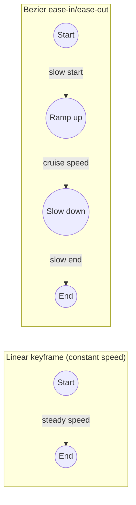

---
aliases:
  - Bezier Ease-In/Ease-Out
tags:
  - glossary/editing-1
  - glossary/premiere
---
# Keyframe Animation (Bezier Ease-In, Ease-Out)

## Definition
Animating a property (position, scale, opacity, etc.) by setting different values at different points in time — Premiere interpolates between them automatically. A Bezier curve applied to a keyframe softens the transition into and out of motion, so a move accelerates smoothly rather than starting and stopping abruptly.

## In Practice
Taught in Lesson 21 on a title's Position property: click the "stopwatch" icon in Effects Controls to start keyframing, animate the title entering from off-screen, then show reorienting keyframes to change speed and adding a Bezier curve for ease-in/ease-out. Framed explicitly as a general introduction to effects and animation broadly — the same keyframing mechanism reappears in Lesson 27's effects work (scale, position, and blur keyframes on the Psycho-shot and track-and-blur demos), so this lesson is really laying groundwork rather than being a one-off Graphics topic.

## Teaching Analogies & Examples
- **A car pulling away from a stoplight vs. a train hitting top speed instantly**: linear keyframes are the train — constant speed the whole way, which reads as robotic. Bezier ease-in/ease-out is the car — it accelerates gradually, cruises, then eases to a stop, which reads as natural.
- Ask students to physically move their own hand from one point to another at a constant speed, then again ramping up and slowing down — the second one just *feels* more like how things move in real life. That felt difference is exactly what the Bezier curve is doing to a keyframe.
## Related Terms
[[Essential Graphics (Graphics Properties)]], [[Track and Blur]]

## Further Resources

#glossary/editing-1
