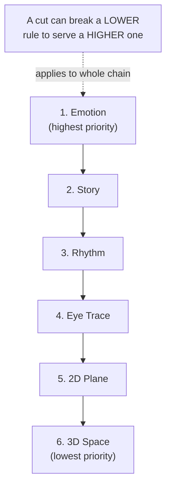

---
aliases:
  - Rule of Six
tags:
  - glossary/editing-1
  - glossary/production-craft
---
# Murch's Rule of Six

## Definition
Legendary editor Walter Murch's priority-ordered framework for what a cut should serve, from most to least important: **1. Emotion, 2. Story, 3. Rhythm, 4. Eye Trace, 5. 2D Plane (screen direction), 6. 3D Space (spatial continuity).** The ordering matters — Murch's claim is that a cut can violate the lower-priority rules (continuity, spatial logic) if doing so serves emotion or story, but rarely the reverse.

## In Practice
Introduced in Lesson 20, deliberately sequenced *after* students have already spent several classes cutting the Jacuzzi dialogue scenes — so "Emotion first" lands as confirmation of instincts they've already been developing, not an abstract rule handed down cold. Directly ties back to the Tom Cross (*La La Land*) interview material from earlier in the semester. Applied hands-on to two specific techniques: extending a reaction beat by trimming off-camera dialogue (Jacuzzi Scene 9), and **Rate Stretch** to slow down a reaction shot for emphasis. [[Eye Trace]] specifically gets its own dedicated example clip ("Editing Eye Trace – Oscars Montage").

## Teaching Analogies & Examples
- **A priority list, not a checklist**: think of it like packing for a trip with a weight limit — Emotion and Story are what you pack first no matter what, and if there's no room left, 3D Space (spatial continuity) is what gets left behind first, not the other way around.
- The "permission to break the rules" framing is the single most useful thing to repeat: a cut that's technically a continuity error can still be the *correct* cut if it serves the emotion — Murch's ordering is explicitly there to give editors permission to make that trade.
- For a quick classroom gut-check: ask "does this cut feel right?" before asking "is this cut technically correct?" — Murch's whole framework argues the first question outranks the second.
## Related Terms
[[Eye Trace]], [[Rate Stretch]]

## Further Resources

#glossary/editing-1
