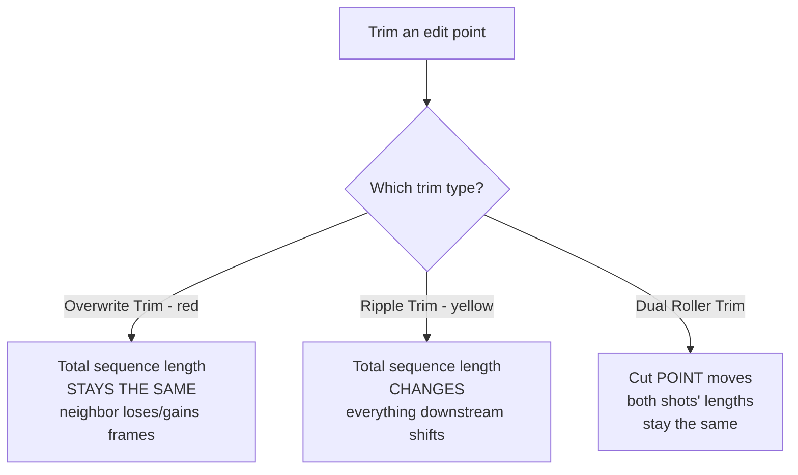

---
aliases:
  - Ripple Trim
  - Dual Roller Trim
tags:
  - glossary/editing-1
  - glossary/avid
---
# Overwrite Trim / Ripple Trim / Dual Roller Trim

## Definition
The three underlying trim types available once inside [[Trim Mode]]: **Overwrite Trim** (red) changes an edit point without moving the rest of the sequence — it trades frames between the two neighboring shots, keeping total sequence length fixed. **Ripple Trim** (yellow) changes a shot's length *and* shifts everything downstream to compensate, changing total sequence length. **Dual Roller Trim** moves both sides of an edit point together as a matched pair, adjusting where the cut falls without changing either shot's individual length.

## Teaching Analogies & Examples
- **A see-saw between two neighbors (Overwrite Trim)**: lengthen one clip and the neighbor loses exactly that many frames — the total length of the sequence never changes, frames just trade hands at the boundary.
- **Squeezing a rubber hose (Ripple Trim)**: change one shot's length and everything downstream physically slides to make room or close the gap — the whole sequence's total length shifts.
- **Grabbing both ends of a piece of string at once (Dual Roller Trim)**: both sides of the cut move together as a pair, repositioning exactly where the cut falls without changing either shot's own length.
- The color coding (red = Overwrite, yellow = Ripple) is worth pointing at literally on screen every time — students retain the color association faster than the names alone.
## Related Terms
[[Trim Mode]]

## Further Resources

#glossary/editing-1
