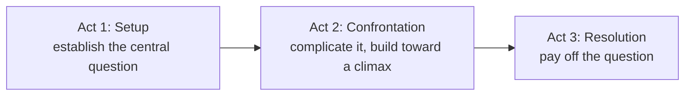

---
tags:
  - glossary/editing-1
  - glossary/production-craft
---
# Three-Act Structure

## Definition
A story-structure framework dividing a narrative into three parts: Act 1 sets up the story's central question, Act 2 develops and complicates it, and Act 3 pays it off.

## In Practice
Introduced in Lesson 8 deliberately as a discussion the students largely construct themselves — the colleague lets the class work out what each act does rather than lecturing the definition, which the outline notes tends to produce "a pretty good discussion." Applied immediately to a stand-up routine (Paul F. Tompkins's "Some College") as a shared case study before moving into documentary structure with *Font Men* and *Slomo*. The framing that "Some College" is fundamentally an "avoiding getting yelled at" story is a specific interpretive lens worth keeping close to verbatim — it's the kind of single-sentence read that makes a structural analysis click for students.

## Teaching Analogies & Examples
- **Setup, confrontation, resolution — like telling a friend about your day**: Act 1 is "here's what was going on," Act 2 is "then this problem showed up and things got complicated," Act 3 is "here's how it got resolved."
- The "Some College" read — that it's fundamentally an "avoiding getting yelled at" story — is itself the best teaching tool here: showing students that naming the *actual* underlying question in one blunt sentence is often more useful than a formal structural breakdown.
- For students who resist "there's always three acts": frame it as a lens, not a law — ask what happens if you try to force a piece into three acts and it doesn't fit; that friction itself is often revealing about the piece's actual structure.
## Related Terms
[[Coverage]]

## Further Resources

#glossary/editing-1
