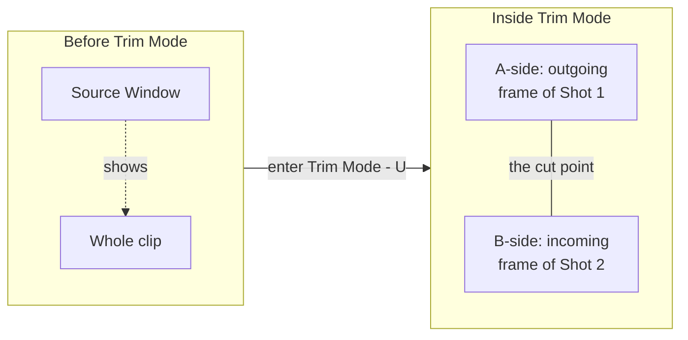

---
tags:
  - glossary/editing-1
  - glossary/avid
  - glossary/premiere
---
# Trim Mode

## Definition
A dedicated editing mode for precisely adjusting an existing edit point, rather than building new material into the sequence. Inside Trim Mode, the interface shifts from showing the Source clip to showing the outgoing frame of the A-side and the incoming frame of the B-side of the cut — the conceptual shift Lesson 10 flags as the biggest adjustment for students moving from basic Overwrite/Splice-In editing.

## Teaching Analogies & Examples
- **The seam between two pieces of fabric**: once two clips are already sewn together, Trim Mode is where you go to adjust exactly where that seam sits — nudging it a little one way or the other rather than ripping the whole seam out and re-sewing.
- Contrast with basic editing: building a sequence with Overwrite/Splice-In is like laying bricks; Trim Mode is coming back afterward with a chisel to fine-tune exactly where one brick meets the next.
- For the shift from Source-window thinking to edit-point thinking: tell students it's like the difference between packing a suitcase (thinking about each item) and standing at airport security deciding exactly where the zipper closes (thinking only about the boundary).
## Related Terms
[[JKL]], [[Extend]], [[Top and Tail]], [[Match Frame]]

## Further Resources

#glossary/editing-1
